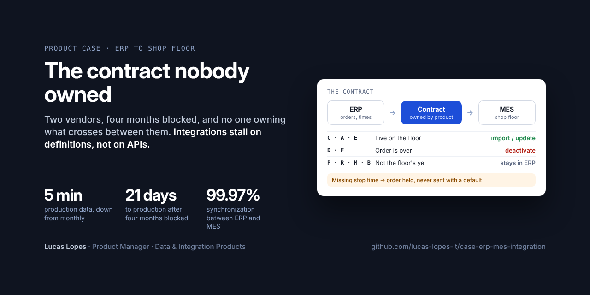

# ERP to Shop Floor: the Production Data Contract



> **Portfolio reconstruction.** The original integration runs in production at Ventisol (fans and
> air conditioners, Santa Catarina, Brazil). This repository **contains no code, data, credentials
> or customer information** from the real environment. Products, orders and lines are fictional. The
> ERP (Sankhya on Oracle) and the MES (Syneco) are represented by their contract, not by their code.

Ventisol had already invested in a MES (Syneco, from SKA) so production planning could run the floor
from it. For almost six months that investment returned nothing: the integration with the ERP was
stuck between the two vendors, and no order ever reached the MES. It went live 21 days after I took
ownership of the one thing nobody owned: the definition of what crosses from one system to the other.
Production data went from monthly to every 5 minutes.

My role: Product Manager for the integration, owning the contract, the go-live decision and the
scope, with both vendors building to it. The full story, in first person, is in
[docs/CASE.md](docs/CASE.md), and the PRD in [docs/PRD.md](docs/PRD.md).

## Outcome

- **The MES investment started to pay off, and became measurable.** The system the company bought
  for planning went from receiving no orders to running 10 lines. Planned against actual cycle is
  now visible order by order, with gaps of up to 19x, so the return on the MES can be calculated
  from data instead of estimated.
- **Cost variance seen the same day, not at month close.** The difference between planned and
  actual cost of an order used to surface when the month closed. With data every 5 minutes, finance
  sees it the same day, per order, instead of through a generic allocation.
- **Production data went from monthly to every 5 minutes.** What the floor produced used to reach
  management once a month, by hand. Now it arrives every 5 minutes, with no one retyping it.
- **About 77 orders a day reach the floor with no manual touch**, across 10 integrated lines.
- **The plant can measure its own efficiency.** In 3 months, 736,727 units and 14,428 stops were
  tracked by reason, data that did not exist in digital form before. With planning, it closed the
  first OEE from source: 1,932.5 productive hours against 15.9 hours of unplanned stops.
- **Live in 21 days** after almost six months blocked between the ERP and MES vendors, with **99.97%
  synchronization** between the two systems.

### Impact by stakeholder

| Who | Before | After |
|---|---|---|
| **Leadership** | A MES already paid for, with no orders in it, and the floor invisible between month closes | 10 lines on the MES, every unit and stop tracked, and an OEE built from source data |
| **Finance** | Planned against actual cost per order known only at month close, through allocation | Variance visible the same day, order by order, and a data base to calculate the MES return without estimates |
| **Commercial** | Delivery dates promised on theoretical capacity | Execution data in the ERP every 5 minutes, available to replan within the same cycle |
| **Vendor management** | ERP and MES reconciled by hand, with no shared error rate | Automatic reconciliation and an auditable error rate in the contract with the MES vendor, with zero duplicated orders even on reprocessing |

## The problem

Production orders lived in the ERP. The shop floor ran on a MES. The integration between them was
stuck: each vendor had its side ready and pointed at the other.

The obvious reading was technical: a missing endpoint, a field mismatch, a vendor not delivering.
The diagnosis was different. Nobody had written down which orders the floor needs to see, which
fields each one carries, where each field comes from and who decides when the data is wrong. The
integration wasn't late. It was undefined.

## Who it is for

| Person | What they do | What they need from the product |
|---|---|---|
| **Production planning** | Releases orders, keeps times and catalog right | Orders on the floor without retyping, and a clear list of what blocks them |
| **Operator and supervisor** | Produces what is due, records stops | A terminal that shows only what can be produced now, with real times |
| **Plant management** | Follows output and stops | Today's numbers, not last month's spreadsheet |
| **IT and both vendors** | Keep each system running | One definition both sides build to |

## The hypothesis and how it was tested

**Riskiest hypothesis:** the integration was blocked by a missing definition, not by a technical
limit on either side.

**Test:** write the contract, put both vendors in front of the same document and ask each one to
build its side to it. If the blocker was technical, the contract would change nothing. The
integration was in production 21 days later.

## Product decisions

| # | Decision | Why |
|---|---|---|
| [P1](docs/DECISIONS.md#p1-own-the-contract-not-either-vendors-code) | Own the contract, not either vendor's code | The blocker was a definition, not an API |
| [P2](docs/DECISIONS.md#p2-integrate-the-lines-that-matter-first-not-the-whole-plant) | Integrate line by line | Each line enters after its own readiness check |
| [P3](docs/DECISIONS.md#p3-only-orders-the-floor-can-act-on-cross-the-boundary) | Only orders the floor can act on cross the boundary | The terminal shows what can be produced now |
| [P4](docs/DECISIONS.md#p4-the-part-comes-from-the-order-no-made-up-numbers-on-the-floor) | The part comes from the order; no made-up numbers | A wrong time is worse than an order that waits |
| [P5](docs/DECISIONS.md#p5-ask-the-go-live-question-from-the-orders-not-the-catalog) | Ask the go-live question from the orders, not the catalog | It turned weeks of cleanup into a short list |
| [P6](docs/DECISIONS.md#p6-go-live-in-the-environment-that-already-behaved-like-production) | Go live in the environment that already worked | A rushed migration was the bigger risk |
| [P7](docs/DECISIONS.md#p7-write-the-scope-down-when-everything-can-mean-two-things) | Write the scope down when "everything" means two things | Same word, two teams, two scopes |

## What was left out, on purpose

- **The whole plant at once.** Lines enter one at a time, each after its own check.
- **Default times.** An order without a time waits; it never reaches the floor with a guess.
- **Owning either vendor's code.** The client owns the definition; each vendor owns its side.
- **The raw-material photos.** They stay with the planner who prepares them; the vendor was asked to
  support her uploads.

## How the product is measured

| Metric | Question it answers | Status |
|---|---|---|
| Lines running on the MES | Is the MES investment being used? | **Measured:** 10 lines, from none |
| Planned against actual cycle, per order | Can the MES return be calculated? | **Measured:** gaps of up to 19x, visible order by order |
| Production data latency | How fresh is what management sees? (north star) | **Measured:** from monthly to every 5 minutes |
| Orders reaching the floor with no manual touch | Did retyping end? | **Measured:** about 77 a day, 10 lines |
| Synchronization between ERP and MES | Does the floor see what the ERP says? | **Measured:** 99.97% |
| Stops tracked by reason | Can the plant explain its downtime? | **Measured:** 14,428 stops; 15.9 h unplanned against 1,932.5 h productive |
| Time from definition to production | Did owning the contract unblock it? | **Measured:** 21 days, after almost six months blocked |
| Orders synchronized | Did the first phase land? | **Measured:** 815 in phase 1 |
| Workflow uptime | Do the integration runs themselves stay up? | **Measured:** 90.2% for the workflows (not the machines); target set for the next phase |
| Held orders and time to release them | Is the data good enough to send? | **Rebuilt here:** every hold carries the field that failed |

## Thesis

Integrations don't stall on APIs. They stall on definitions nobody owns. The most useful product
work in an integration is writing down what crosses the boundary and being the person who decides
when the two sides disagree.

## Try the go-live check

Requires Node 22 or later. No credentials needed: everything runs on a fictional ERP snapshot.

```bash
npm install
npm test            # 39 tests: situation rule, payload contract, readiness, sync plan
npm run readiness   # the go-live check over the fictional snapshot
npm run sync:plan   # one sync run, then a second run that sends nothing new
```

`npm run readiness` prints:

```text
# Go-live readiness

Lines in scope: LINE-A, LINE-B, LINE-C, LINE-D
Live orders (C, A, E): 27, covering 26 products
Verdict: NOT READY

- BLOCKER stopToleranceMinutes is missing or not positive
  orders: 50058, 50059 | products: 1102
- RISK active parts share the description "PEDESTAL FAN 50CM BIVOLT BLACK"
  orders: 50006, 50057 | products: 1003, 1101
- INFO inactive products appear only on closed orders
  orders: 50060, 50061, 50062 | products: 1201, 1202

## The question we stopped asking

Anchored on formulas, 61 products look "without times". Anchored on live orders, 1 product(s) actually block go-live.
```

That last line is decision P5 in one sentence.

## What this repository shows

| Part | Where | Status |
|---|---|---|
| The contract, as a document | [docs/CONTRACT.md](docs/CONTRACT.md) | written |
| Order situation rule | `src/contract/orderState.ts` | rebuilt, tested |
| Payload contract, with holds instead of defaults | `src/contract/payload.ts` | rebuilt, tested |
| Go-live readiness anchored on orders | `src/contract/readiness.ts` | rebuilt, tested |
| Sync plan with memory of what was sent | `src/sync/plan.ts` | rebuilt, tested |
| Orchestration in n8n, chat summaries, document generation | | described, not rebuilt |

## Documentation

**The product**
- [docs/CASE.md](docs/CASE.md): the story, in first person
- [docs/PRD.md](docs/PRD.md): problem, users, requirements, metrics and risks
- [docs/CONTRACT.md](docs/CONTRACT.md): what crosses the boundary, and who owns each part
- [docs/product/roadmap.md](docs/product/roadmap.md): roadmap by capability
- [docs/BACKLOG.md](docs/BACKLOG.md): two epics, stories with Given/When/Then, vendor dependencies and priority

**How I think**
- [docs/vision/vision.md](docs/vision/vision.md): mission and direction
- [docs/vision/manifesto.md](docs/vision/manifesto.md): what I believe about integrations
- [docs/vision/principles.md](docs/vision/principles.md): the rules that break ties
- [docs/vision/glossary.md](docs/vision/glossary.md): the domain terms

**How I decide and learn**
- [docs/DECISIONS.md](docs/DECISIONS.md): product and build decisions, with alternatives and accepted cost
- [docs/sprints/](docs/sprints/README.md): review, retrospective and learning for each sprint

## Contributing

See [how to contribute](docs/contributing/contributing.md), the [Code of Conduct](CODE_OF_CONDUCT.md)
and the [Security Policy](SECURITY.md).

## License

[MIT](LICENSE).
